# xsection-nn-alpha

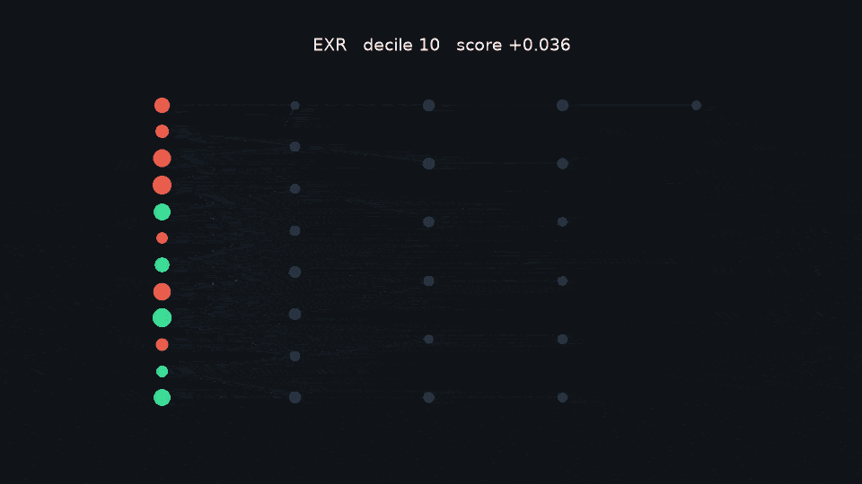

A neural network that ranks US large-cap stocks each month, trained only on data that was knowable at the time, and scored against linear and tree baselines in an expanding-window backtest.

The published result is not "the network won." Net of 10 basis points per side, the MLP long/short book has a Sharpe of **0.81**. LightGBM is **0.93**. A momentum-plus-reversal score is about zero. Details are in [reports/results.md](reports/results.md).

Author: Devasai Choppa — [github.com/TechieGoku2623](https://github.com/TechieGoku2623)

## Watch the demo

[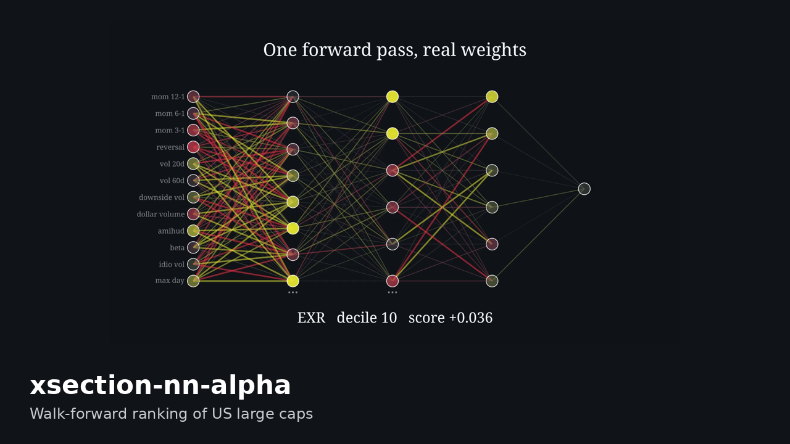](demo/demo.mp4)

`demo/demo.mp4` is the two-minute narrated walkthrough (1080p). `demo/demo_short.mp4` is a 45-second vertical cut. GitHub's README viewer does not play a video from the repository browser. To embed it, drag `demo/demo.mp4` into the README editor on GitHub, or upload it to YouTube and replace this thumbnail link.

## Problem

Each month-end, score every name in a large-cap universe by predicted next-month return. Go long the top decile and short the bottom decile, equal weight, and charge a realistic cost on turnover. The question is whether a small MLP, trained without seeing the test months, ranks names better than a linear model, a gradient-boosted tree, or a hand-built momentum score.

## Approach

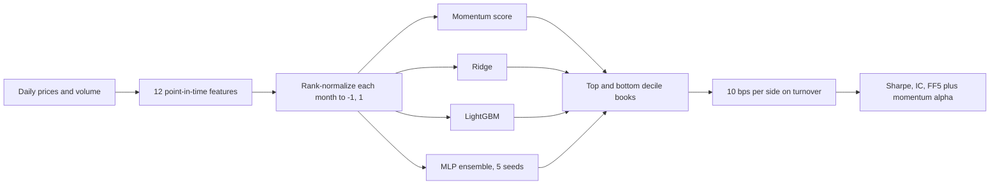

The network is 12 → 64 → 32 → 16 → 1, with SiLU, batch norm, and dropout. The target is the cross-sectional rank of next-month return, mapped to [-1, 1]. The loss is mean squared error plus an optional pairwise ranking penalty. Five seeds are averaged for the portfolio. The animations use seed 0, whose activations are saved.

Features, all computed from data available on the signal date:

| Feature | What it is |
| --- | --- |
| mom 12-1, 6-1, 3-1 | Total return over the window, skipping the last month |
| reversal | Last month's return, signed so a recent drop scores high |
| vol 20d, vol 60d, downside vol | Realized and downside volatility |
| log dollar volume, Amihud | Liquidity |
| beta 252d, idiosyncratic vol | Market exposure versus SPY |
| max daily return | Largest up-day in the last month |

Each feature is rank-normalized within the month to [-1, 1]. Missing values are filled with that month's median, and only after the raw lookback for that feature actually exists. A name with no 12-month history is dropped, not filled.

## Results

Expanding-window test months only, January 2012 through September 2026 (177 months). Hyperparameters were chosen on a time-series split inside each training window. Nothing below was selected by looking at the test period.

Long/short, net of 10 bps per side:

| Model | Ann. return | Vol | Sharpe | Sortino | Max DD | Turnover | Hit rate | Rank IC | Alpha (ann.) | Alpha t |
| --- | --- | --- | --- | --- | --- | --- | --- | --- | --- | --- |
| Momentum + reversal | -1.55% | 13.71% | -0.05 | -0.06 | -51.23% | 1.75 | 46.33% | 0.006 | -3.91% | -1.11 |
| Ridge | 10.47% | 14.73% | 0.75 | 1.41 | -20.71% | 0.96 | 54.24% | 0.024 | 9.70% | 3.35 |
| LightGBM | 10.46% | 11.43% | 0.93 | 1.91 | -12.32% | 1.27 | 58.76% | 0.025 | 8.46% | 3.60 |
| MLP ensemble | 9.82% | 12.50% | 0.81 | 1.50 | -19.02% | 1.05 | 58.19% | 0.015 | 8.88% | 2.96 |

Long-only books earn more because the market went up. Net of costs, the MLP long-only Sharpe is 1.23 with about 10.6% annual alpha over FF5 plus momentum. Gross and long-only tables, information coefficients, and the hyperparameter chosen in each window are in [reports/results.md](reports/results.md).

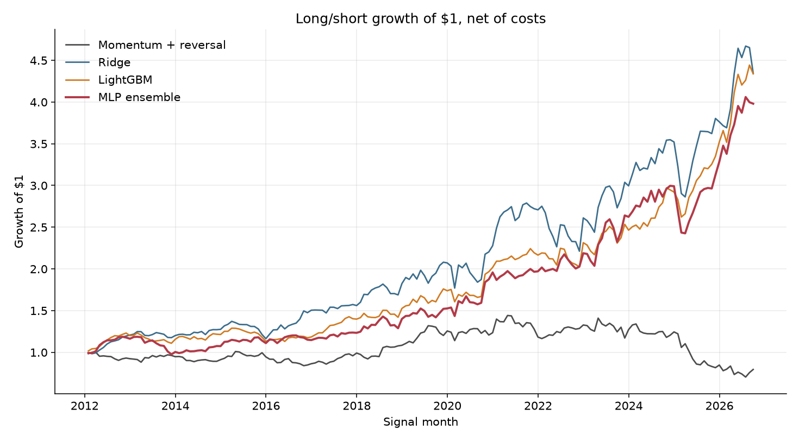

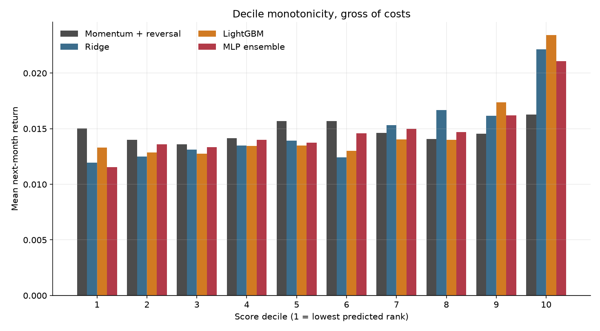

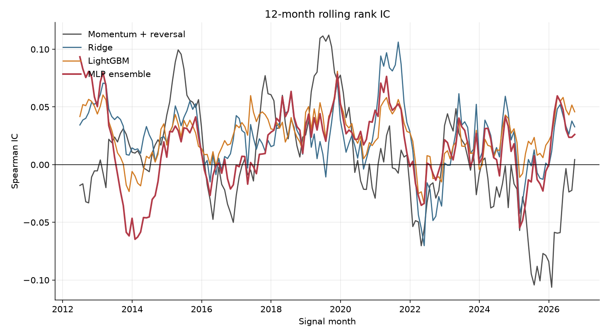

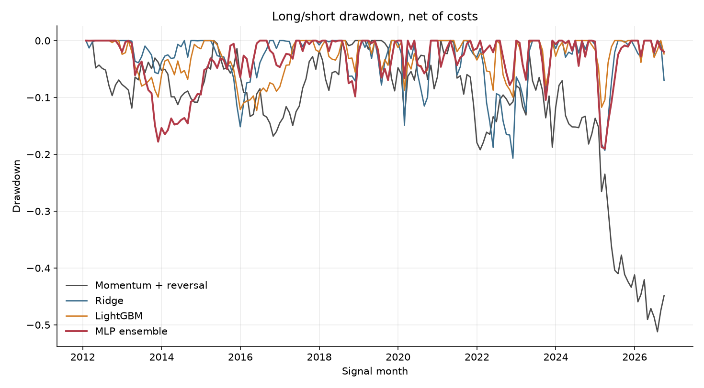

## How the network sees a stock


Neuron color is the real activation for that stock. Edge color is the sign of the real weight, and thickness is its magnitude. Wide layers are an even subset; the "..." in the Manim scene marks the neurons that were left out of the drawing. The full scene is `media/videos/manim_scenes/1080p60/ForwardPass.mp4`.

## GIF gallery

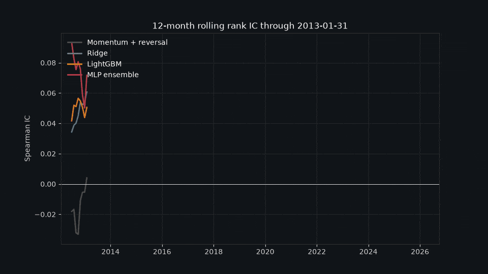

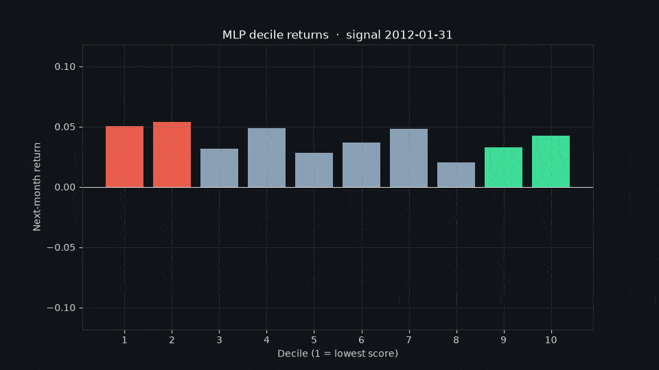

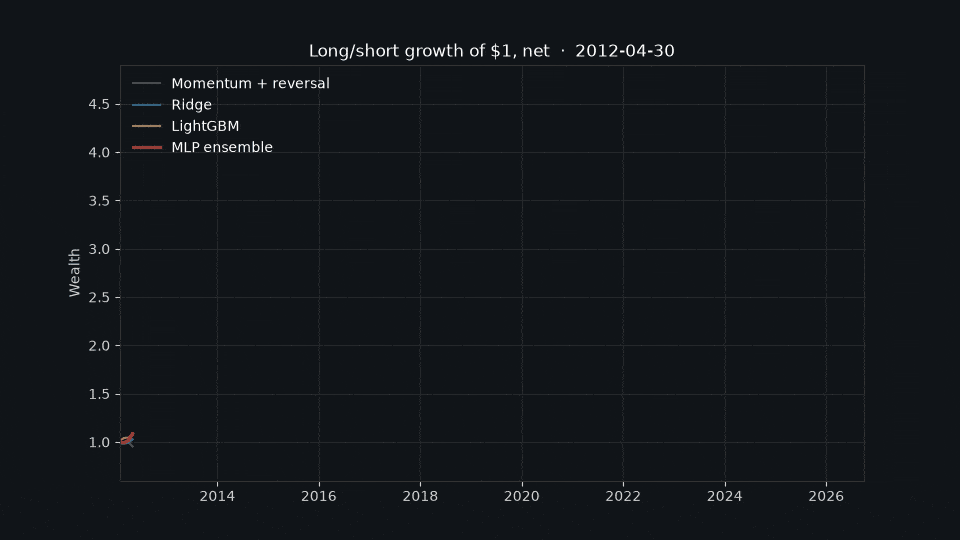

## Dashboard

`make app` opens a Streamlit viewer on port 8501.

- **Rank a month.** A slider over every test month, the ranked universe, the long and short books, a Plotly diagram of the sampled network at the selected ticker, a PyVis graph of the same pass, and Captum integrated gradients for the twelve features.
- **Backtest.** Model and book selectors. The cost slider reprices the saved turnover. It does not refit the model.
- **How it works.** The five Manim scenes.

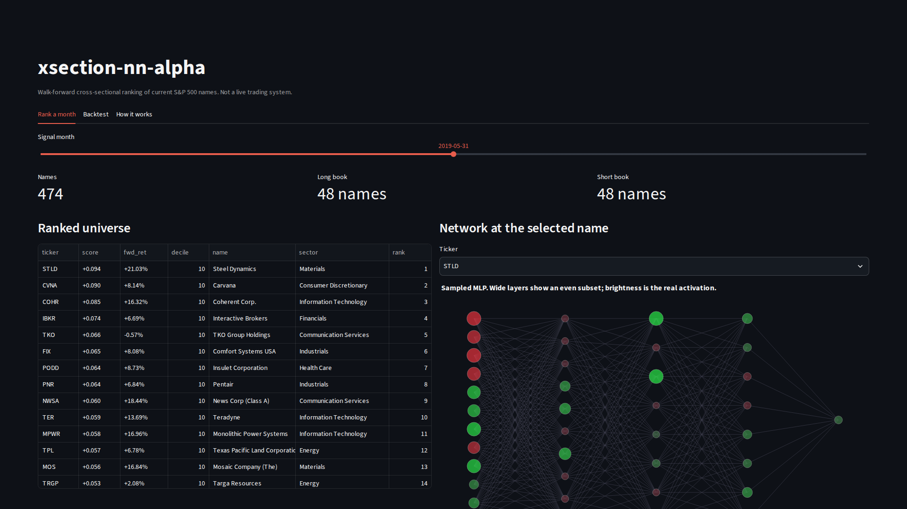

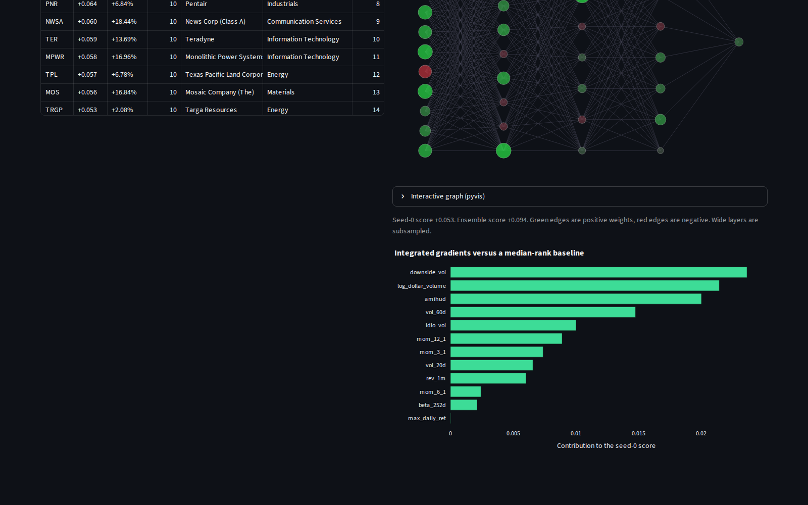

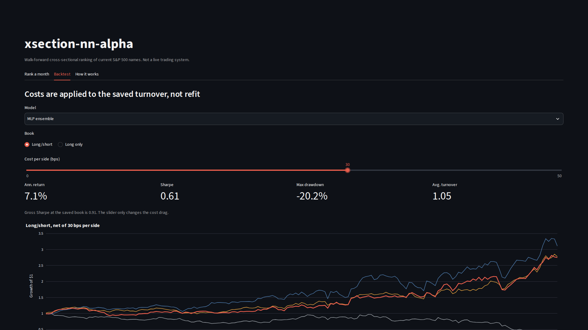

## Reproduce

One-time setup:

```bash
python -m venv .venv
.venv/bin/pip install -e ".[dev,viz]"
.venv/bin/playwright install chromium
```

System packages the animations and the demo need: `ffmpeg`, `gifsicle`, and the Cairo/Pango libraries Manim links against. On Windows, run Manim from WSL. `playwright install chromium` downloads the browser the demo recorder drives.

Then three commands:

```bash
make data      # cache prices and Ken French factors under data/raw
make all       # train, backtest, test, and render scenes plus GIFs
make video     # narrated demo.mp4, demo_short.mp4, and thumbnail.png
```

`make app` starts the dashboard. `make test` is pytest. `make lint` is ruff. Paths and the hyperparameter grids live in `configs/default.yaml`.

The committed `data/processed`, `activations`, and `reports` trees are the run that produced the tables above, so the dashboard and the figures open without retraining. `make data` then `make all` rebuilds them. Raw downloads and the per-epoch checkpoint tree are gitignored; the last seed-0 network of each window is copied to `data/processed/networks` for the viewer.

## Methodology

- **Walk-forward.** The first test block starts in 2012. The model is refit every 12 months. Training history expands. It is not a rolling window.
- **Embargo.** One month is dropped between the last training label and the first test date, and the label horizon is one month. A training label cannot end on the first test date.
- **Tuning.** Dropout, the pairwise-loss weight, and the epoch count for the MLP, plus Ridge alpha and the LightGBM leaf settings, are chosen by mean Spearman IC on the last 24 months of the training window, behind the same embargo. The test block is not in that split. Seeds are fixed.
- **Books.** Top decile long, bottom decile short, equal weight. A long-only book is reported beside it.
- **Costs.** One-way turnover is `0.5 * sum(|w_t - w_{t-1}|)`, including the first month, which starts from a flat book. The default charge is 10 bps per side, `turnover * cost_bps / 10000`. Gross and net are both reported.
- **Attribution.** Net monthly returns are regressed on Ken French five factors plus momentum, with Newey-West standard errors (3 lags). Long-only alpha is the excess over the risk-free rate.
- **No lookahead check.** `tests/test_features.py` appends future prices and requires the features at earlier dates to be unchanged.

## Limitations

- **Survivorship bias.** The default universe is today's S&P 500, from Wikipedia. Names that left the index are missing, and that flatters every model. A point-in-time file can be passed as `data.pit_constituents_csv`. The loader accepts either `date, ticker` (one row per constituent-month) or `ticker, start_date, end_date`.
- **Free data.** Prices and volume come from Yahoo Finance through `yfinance`. Adjusted closes, missing days, and ticker changes are only as good as that feed. Factors are the Ken French daily files.
- **Capacity.** Decile books on large caps at this turnover are not a statement about how much capital they can take. Borrow, impact, and short locate are not modeled. Ten basis points is a flat assumption, not a measured spread.
- **The search is small.** LightGBM's tree count and learning rate are fixed. The MLP grid is dropout, a pairwise weight, and a short epoch sweep. A larger search could move the ranking. It would still have to stay inside the training window.

## What didn't work

- The equal-weight momentum-minus-reversal score loses money after costs (Sharpe -0.05, max drawdown about -51%). Gross of costs it is still only barely positive. The classic 12-1 signal is in the feature set; as a standalone rank it does not survive this universe and this cost.
- The MLP does not beat LightGBM out of sample. Test rank IC is 0.015 for the ensemble versus 0.025 for LightGBM and 0.024 for Ridge. Inner-validation rank IC often preferred the network (several windows print an inner IC above 0.04, and one above 0.07). That gap between the inner split and the test block is the result, not a reason to retune.
- The pairwise term was selected in most windows (`rank_lambda` 0.2) and turned off in two. It did not produce a higher test rank IC than the linear model.
- Long-only Sharpes above 1 are mostly the equity market. The factor alpha is the number to read, and it is smaller than the raw Sharpe.

## Future work

- A real point-in-time membership history, so the survivorship bias is measured instead of described.
- Delisting returns and a borrow-cost model on the short leg.
- A wider model search that is still locked to the inner split: deeper trees, a ranker objective in LightGBM, and a longer MLP sweep.
- Sector-neutral books. The current deciles can be a sector bet.

## Layout

```
src/xsnn/          data, features, models, walk-forward, backtest, metrics
src/xsnn/viz/      Manim scenes, GIFs, network diagrams
app/streamlit_app.py
scripts/           download, train/backtest, render, demo video
configs/default.yaml
notebooks/         01_eda.ipynb, 02_results.ipynb
reports/           results.md, figures, gifs
media/             Manim 1080p60 renders
demo/              narration, demo.mp4, demo_short.mp4, thumbnail.png
```

Continuous integration runs ruff and pytest. It does not install the visualization extra.

## License

MIT. Not investment advice. The backtest is a research record of one configuration on free data.
